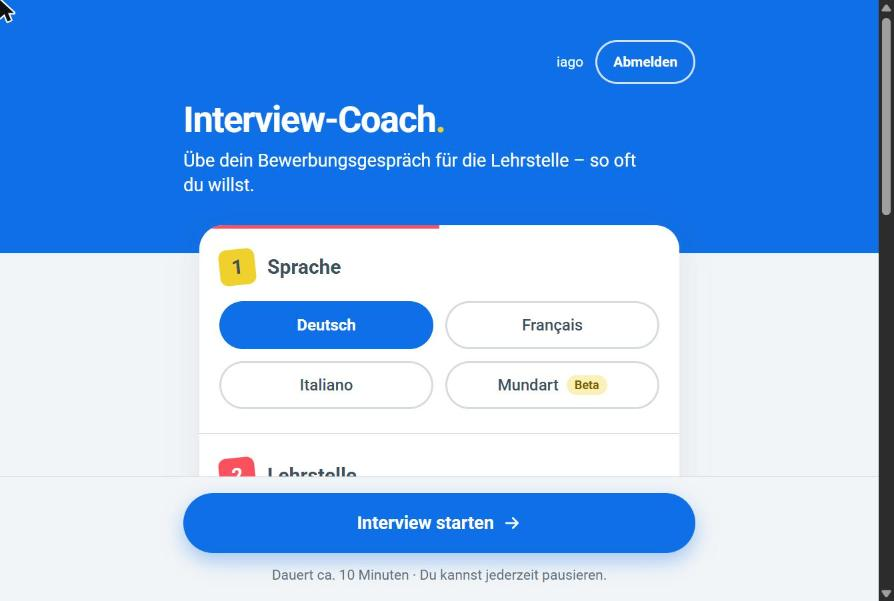
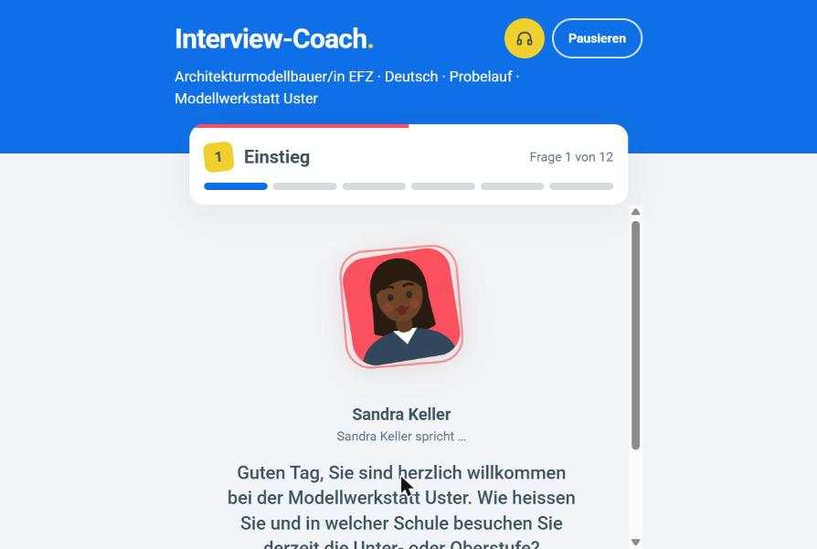
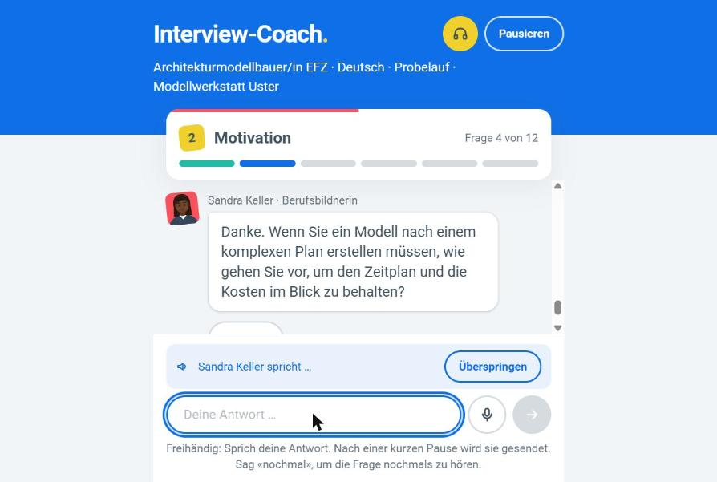
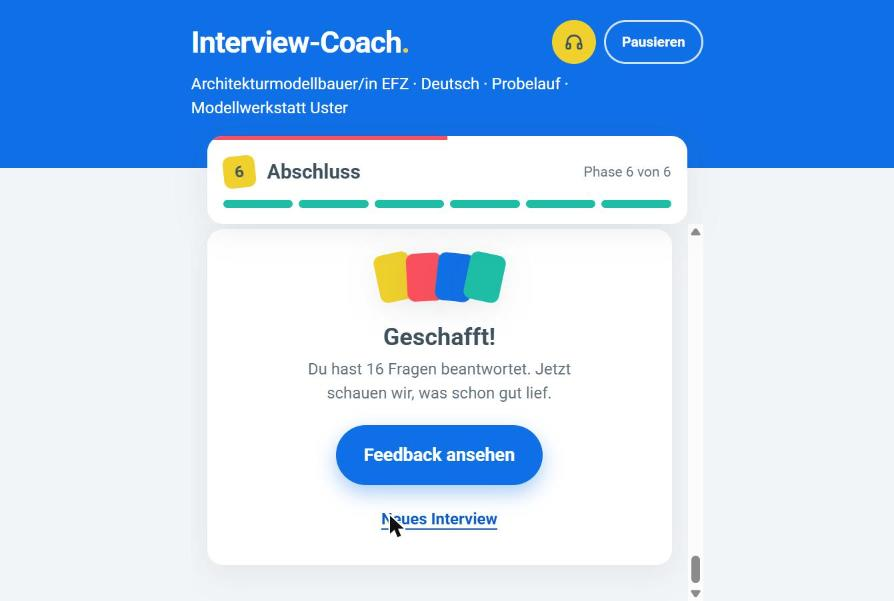
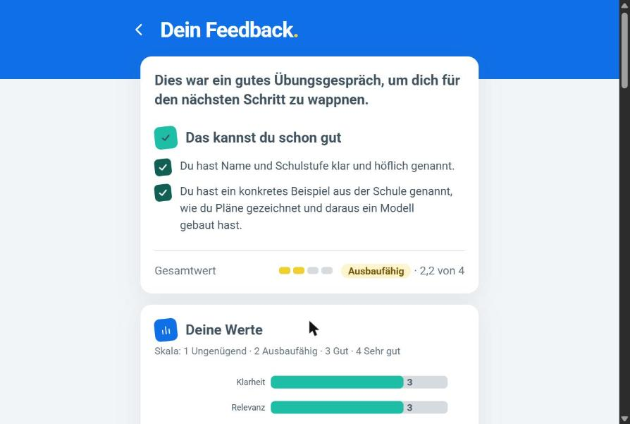
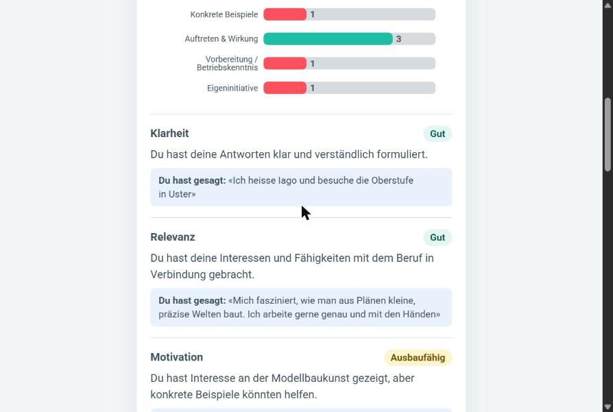
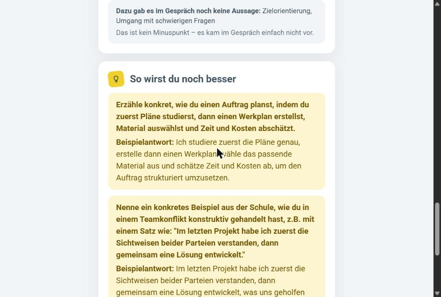

# Schnupper Interview Coach

**Hack Apertus · Track 2A · FHGR: AI-Powered Job Interview Coach**

A practice job interview for school students (about 14-16) applying for an apprenticeship in Switzerland.
The candidate picks an occupation, a language and an interviewer style, answers questions in a chat or by voice,
gets a short tip after every answer, and receives a feedback report at the end.
All runtime LLM inference uses **Apertus v1.5 8B**.

- **Languages:** German, French, Italian, and Swiss German (Mundart: Zürich, Bern, Basel, Graubünden, Valais; beta)
- **Occupations:** a searchable list of Swiss apprenticeships in DE/FR/IT; each interview plays at a fictional
  FHGR company with its own trainer, or at the company from the candidate's uploaded application letter
- **Modes:** *training* (tip and scores after every answer) or *rehearsal* (feedback only at the end)
- **Interviewer styles:** friendly (du/tu) or strict (Sie/vous/Lei); the coach's feedback always uses du/tu
- **Voice:** hands-free mode: the interviewer speaks (Piper, local), the candidate answers by voice
  (Whisper with a Swiss German fine-tune, local), shown in an animated call view
- **Accounts (optional):** log in to keep interviews and reports; guests can use everything

Team: Iago (backend), Anina (frontend)

## Screenshots

A test interview in the browser (Architekturmodellbauer/in EFZ, German, typed answers):

| Setup | Interview start | Chat |
|---|---|---|
|  |  |  |

| End | Feedback | Scores | Tips |
|---|---|---|---|
|  |  |  |  |

Fixed after these screenshots were taken:

- The end card counted every message ("16 Fragen") instead of the 12 main questions shown during the interview.
- The same quote could be shown as evidence for several criteria; now each quote appears once.
- A strength could praise something whose criterion scored 1 (e.g. concrete examples); strengths now only come
  from criteria with 3 or 4.
- In the motivation phase the interviewer could ask how the candidate would do a task (as in the chat screenshot);
  those questions now come in the situational phase.

## Results in short

Measured with Apertus v1.5 8B on the FHGR development data (judge: Apertus v1.5 70B; details and all numbers in
[technical_report.md](technical_report.md), section 5):

| What | Result |
|---|---|
| LLM calls per answer (gate < 5) | 1.92 on average, at most 3 (12 full interviews) |
| Scenario success criteria met (judge) | 95 % |
| Report comments backed by a real quote of the candidate | 72-75 % |
| Judge on full interviews: grounding / accuracy / tone (1-4) | 3.67 / 3.92 / 4.08 |
| Overall score spread over repeated runs (std) | 0.05-0.16 |
| Problem flags (distress, manipulation, …): precision / recall | 0.90 / 0.47 |

## Run it

Requirements: Docker with Compose v2 and an Apertus API key from CSCS. No GPU is needed.
Apertus is called through the [CSCS LLM inference API](https://docs.cscs.ch/services/inference/api/#llm-inference-api-service).
The voice models (Whisper and Piper, about 2.5 GB, CPU only, about 3 GB RAM) are downloaded into `data/models`
on the first start and preloaded in the background; until then, or with `STT_ENABLED=false` / `TTS_ENGINE=off`,
the web app uses the browser's own speech features. The microphone works on `http://localhost`; from another
device the web app needs HTTPS (browsers only allow the microphone on secure pages).

```bash
cp .env.example .env      # fill in LLM_NAME, LLM_BASE_URL, LLM_API_KEY
make run                  # = docker compose up --build
```

| Service | URL |
|---|---|
| Web app | http://localhost:8080 |
| Backend API | http://localhost:8000/api/v1 |

`.env` needs these three variables (see `.env.example`):

```
LLM_NAME=swiss-ai/Apertus-v1.5-8B
LLM_BASE_URL=https://api.inference.cscs.ch/v1
LLM_API_KEY=<your CSCS key>
```

Without `.env` the services still start and `/api/v1/health` works, but every endpoint that needs Apertus
returns `502 LLM_UNAVAILABLE`.

Nothing has to be hosted: as the challenge asks, everything runs locally with `make run` (Docker), and the
only external service is the CSCS endpoint for Apertus.

### Challenge requirements

| Requirement (FHGR) | How we meet it |
|---|---|
| Apertus 1.5 8B as the model | The only LLM at runtime (`LLM_NAME`, `LLM_BASE_URL`, `LLM_API_KEY`) |
| < 32 GB VRAM, consumer hardware, on-premise | Apertus 8B fits in < 32 GB; our container needs no GPU (Whisper and Piper run on the CPU) |
| < 5 LLM calls per answer (average) | 1.92 measured (3 in Mundart), logged per answer (see [call budget](#llm-call-budget-gate-average--5-per-answer)) |
| Docker container, `make run`, source, docs, visual overview | `make run` in this folder; this README, [technical_report.md](technical_report.md) and [docs/api.md](docs/api.md); diagrams in [docs/architecture.md](docs/architecture.md) |
| DE, FR, IT; Swiss dialects a plus | All three, plus Mundart in five dialects (beta) |
| Voice-ready (real-time TTS later) | Already spoken: Piper/Azure TTS and Whisper STT with a hands-free mode |

Quick check without the web app:

```bash
curl localhost:8000/api/v1/health
curl -X POST localhost:8000/api/v1/sessions -H 'Content-Type: application/json' \
     -d '{"language": "de", "occupation_id": "informatiker_efz", "interviewer_style": "friendly", "mode": "training"}'
curl -X POST localhost:8000/api/v1/sessions/<session_id>/answers -H 'Content-Type: application/json' \
     -d '{"question_id": "q1", "text": "Ich bin Lara und baue gerne PCs zusammen."}'
curl localhost:8000/api/v1/sessions/<session_id>/report     # after the last answer
```

## How it works

```
Browser (React) ──REST /api/v1──────────┐          Aegra server (port 8000, Postgres)
                                        ├──> same LangGraph nodes ──> Apertus v1.5 8B (CSCS)
Judge / Agent Chat UI ──Agent Protocol──┘    analysis call (11 criteria, JSON) -> interviewer call
                        graph `agent`
```

- **Two interfaces, one server.** As in the FHGR project template, [Aegra](https://github.com/aegra/aegra) serves
  the LangGraph graph `agent` (`src/backend/agent.py`, chat in / chat out, one thread = one interview) and our
  FastAPI app with the REST API for the frontend (`aegra.json` "http.app"). Both use the same nodes.

- **Two LLM calls per answer.** An *analysis call* scores the answer on the FHGR rubric
  (11 criteria from `datasets/rubric/criteria.json`, 1-4, `null` when the answer shows nothing about
  a criterion) and writes a short tip.
  An *interviewer call* then asks the next question or a follow-up.
- **The phase flow is decided in code, not by the LLM,** so every interview follows the same structure:
  intro (2 questions) → motivation (3) → strengths/weaknesses (3) → situational (3) → candidate questions → closing.
  That makes 12 main questions (FHGR: 10-15). Each phase allows at most one follow-up when an answer is vague.
- **A real company.** Each session uses an FHGR posting (fictional company, real occupation): the interviewer
  plays the posting's trainer, answers the candidate's questions as the company, and the analysis knows
  what a well-prepared candidate could know about it (`preparation`). If the candidate uploads an application
  letter (PDF, .docx, .txt), the company and contact person from the letter replace the posting, and the
  interviewer asks about points from the letter.
- **Mundart.** The interviewer writes Standard German, a second call turns it into the chosen dialect, with
  parallel examples from the FHGR question bank (`interview/dialect.py`): more reliable than asking the 8B model
  to interview in dialect directly. Tips and the report stay in Standard German, which is easier to read.
  In the candidate-questions phase the candidate asks and the interviewer answers; the question is
  analysed for `initiative`.
- **Robust JSON.** The model's output is repaired in code where possible (code fences, extra text,
  trailing commas, scores like `"3/4"`, missing braces, escapes like `\u00e9`, …). Only unusable output is
  retried, up to 3 attempts.
- **Checked replies.** A reply that asks nothing, repeats an earlier question, is in English, or answers the
  candidate's question with thanks only is asked once more; if that fails too, a fixed line stands in.
- **Voice, without an LLM call.** `POST /transcribe` turns a spoken answer into text with Whisper
  (faster-whisper on the CPU; for German and Mundart a Swiss German fine-tune of large-v3-turbo that writes
  Standard German). `POST /speech` reads the interviewer's lines with Piper (local) or, with
  `TTS_ENGINE=azure`, Azure's Swiss voices. The interviewer's voice (female/male) comes from the posting
  (`data/interviewer_voices.yaml`). Models (about 2.5 GB) are downloaded into `data/models` on the first start.
  In the frontend's hands-free mode the question is read aloud, the answer is recorded until a pause,
  transcribed, shown for 2 seconds and sent; the call view animates the real loudness of both voices.
  Without server voice (mock, `STT_ENABLED=false`, `TTS_ENGINE=off`) the browser's speech features are used.
- **The report** is generated with one LLM call when first requested, then cached. Scores and the overall
  score are averages computed in code. The LLM writes the comments, strengths and improvement tips.
  Quotes used as evidence are kept only if the candidate really said them. A report that breaks off is asked
  once more; comments still missing take the per-answer tip.

### LLM call budget (gate: average < 5 per answer)

| Step | Calls |
|---|---|
| Answer in a scored phase | 2 (3 when the reply is asked again; up to 2 more for JSON retries of the analysis) |
| Answer in the candidate-questions phase | 1 (0 if the candidate has no more questions) |
| Opening question | 1 |
| Mundart: each interviewer text | +1 (translation into the dialect) |
| Uploaded application letter | 2 per session, at the same time (summary and letter review) |
| Final report | 1 (+1 when it breaks off or uses the third person, + JSON retries), once per session |
| Voice (`/transcribe`, `/speech`) | 0 (Whisper and Piper, no LLM) |

A full interview is about 2 calls per answer (measured: 1.92, at most 3), 3 in Mundart. Every LLM call is logged as one JSON line
(`"event": "llm_call"`), and every answer logs its `calls_per_answer`:

```bash
docker compose logs backend | grep '"event": "answer"'
```

## API

The frontend and backend share the contract in [docs/api.md](docs/api.md): endpoints, JSON shapes, error codes.
All errors use `{"error": {"code": "...", "message": "..."}}`.

## Agent Protocol (graph `agent`)

Any Agent Protocol / LangGraph SDK client can run an interview as a chat (e.g. the FHGR judge or the
[Agent Chat UI](https://github.com/langchain-ai/agent-chat-ui) with deployment URL `http://localhost:8000`,
graph id `agent`). The first message starts the interview; every further message is one answer; at the end the
coach sends the goodbye and the final feedback. Optional setup in the run's `config.configurable`: `language`,
`occupation_id`, `posting_id`, `interviewer_style`, `mode` (default `rehearsal`), `candidate`, `focus`. Without
it, the language is guessed from the first message and the occupation is matched against the FHGR postings.

```bash
T=$(curl -s -X POST localhost:8000/threads -H 'Content-Type: application/json' -d '{}' | jq -r .thread_id)
curl -s -X POST localhost:8000/threads/$T/runs/wait -H 'Content-Type: application/json' \
  -d '{"assistant_id": "agent", "input": {"messages": [{"role": "user", "content": "Hallo, ich bewerbe mich als Informatikerin."}]}}' \
  | jq -r '.messages[-1].content'
```

`SERVER=uvicorn docker compose up` runs only the REST API (no Postgres), as a fallback.

## Project structure

| Path | What it is |
|---|---|
| `aegra.json` | Aegra config: graph `agent` + our FastAPI app |
| `src/backend/agent.py` | Graph `agent` for the Agent Protocol (chat in, chat out) |
| `src/backend/main.py` | FastAPI app: endpoints, error format, CORS |
| `src/backend/llm.py` | Apertus client (OpenAI-compatible) and LLM call counter |
| `src/backend/accounts.py` | Accounts, login tokens and saved interviews (SQLite) |
| `src/backend/config.py` | Setup options (languages, occupations, styles, modes) |
| `src/backend/interview/graph.py` | LangGraph turn: analysis → interviewer |
| `src/backend/interview/phases.py` | Phase logic and progress |
| `src/backend/interview/prompts.py` | Criteria, phase goals and all prompts |
| `src/backend/interview/parsing.py` | Robust JSON parsing and retries |
| `src/backend/interview/report.py` | Final report |
| `src/backend/interview/rubric.py` | FHGR rubric (11 criteria, 1-4) from `datasets/rubric/` |
| `src/backend/interview/safety.py` | Guardrails: crisis, distress, redirect |
| `src/backend/interview/dialect.py` | Mundart: Standard German → dialect with examples from the question bank |
| `src/backend/interview/application.py` | Uploaded application letter: text, summary, company and contact |
| `src/backend/interview/letter_review.py` | Feedback on the application letter (5 criteria, shown in the report) |
| `src/backend/interview/examples.py` | Expert examples from the FHGR annotations for the analysis prompt |
| `src/backend/voice/` | Whisper speech-to-text (`stt.py`) and Piper/Azure text-to-speech (`tts.py`) |
| `src/backend/tests/` | Tests (fake LLM, no network) |
| `src/eval/run_interview.py` | Interview runner: plays a full interview against the API |
| `src/eval/bench_*.py` | Benchmarks on the FHGR data (see below) |
| `datasets/`, `fhgr/` | FHGR challenge data, slides and project template (copied unchanged) |
| `frontend/` | React web app (see `frontend/README.md`) |
| `data/` | Occupations, interviewer styles and voices (YAML); `data/models/` holds the downloaded voice models (not in git) |
| `docs/` | API contract (`api.md`), architecture diagrams (`architecture.md`), challenge text |
| `technical_report.md` | Architecture, use of Apertus, evaluation, limitations |

## Development

Backend tests (Python 3.12):

```bash
pip install -r src/backend/requirements-dev.txt
pytest
```

Backend without Docker:

```bash
pip install -r src/backend/requirements.txt
PYTHONPATH=src uvicorn backend.main:app --reload --port 8000
```

Frontend dev server (http://localhost:5173): see `frontend/README.md`.

## Test a whole interview (interview runner)

`src/eval/run_interview.py` plays one complete interview against the running backend and checks the
LLM call gate. The candidate is scripted (fixed answers) or simulated by Apertus (`--candidate llm`).

```bash
make run    # in a second terminal:
docker compose exec backend python -m eval.run_interview --language de
docker compose exec backend python -m eval.run_interview --language fr --candidate llm --level weak
```

It prints every question, answer, tip and `llm_calls`, then a summary (average and maximum calls per
answer, follow-ups, JSON retries, latency, report score) and saves the run as JSON in `data/eval/runs/`.
Exit code 0 = gate OK, 1 = average ≥ 5 calls per answer, 2 = API error. Options: `--help`.

## Benchmarks (FHGR data)

Four benches measure the coach against the FHGR development data in `datasets/` (not the hidden
benchmark). They call Apertus through the backend code, so run them in the backend container.
Results are saved as JSON in `data/eval/bench/`.

```bash
# 1. Analysis call vs. 816 expert-annotated answers (MAE, agreement, follow-up precision/recall)
docker compose exec backend python -m eval.bench_answers --sample 120
docker compose exec backend python -m eval.bench_answers --sample 120 --variant baseline   # naive prompt

# 2. The 21 gold interviews through analysis + report vs. the reference feedback,
#    deterministic checks (du/Sie, language, empty texts, mojibake) and the LLM judge
docker compose exec backend python -m eval.bench_transcripts --repeat 2

# 3. FHGR scenarios as full interviews through the API, Apertus plays the candidate from the
#    FHGR profile; call gate, checks, consistency, score vs. persona level, scenario success criteria
docker compose exec backend python -m eval.bench_interviews --limit 6 --repeat 2

# 4. Mundart: share of interviewer texts that look like the chosen dialect
docker compose exec backend python -m eval.bench_dialect --runs 2
```

The judge (`src/eval/judge.py`) is an open model, e.g. Apertus 70B, set with `JUDGE_NAME` in `.env`.
It rates the final feedback on grounding, accuracy, actionable next steps, tone and language, using
the FHGR feedback rules. Without `JUDGE_NAME` the judge is skipped. The coach itself only uses Apertus 8B.

## Limitations

- Sessions are stored in SQLite (`data/sessions/sessions.db`, set by `SESSIONS_DB` in docker-compose) and survive a restart. Without `SESSIONS_DB` (tests, local dev) they are kept in memory.
- Interviews of logged-in users are also saved as readable copies in SQLite (Docker volume `storage`, `/me/interviews`).
- Accounts are minimal: username and password only, no e-mail, no password reset. Failed logins are rate limited per IP (in memory; behind a proxy all users share one IP). Users can delete their account. No HTTPS in the demo setup: put a TLS proxy in front for real use.
- Swiss German (`gsw`) is a beta: the 8B model may mix in Standard German or spell inconsistently.
- When the candidate starts a role play ("you are the customer") or asks to plan a meeting, the interviewer may
  play along instead of staying in the interview.
- Scores are a bit stricter than the FHGR experts' (bias about -0.7 on full interviews), most in Swiss German.
- Speech-to-text runs at about real time on a laptop CPU: a 10-second answer takes a few seconds to transcribe.
  `STT_MODEL=small` is faster for French/Italian, at lower accuracy.
- Mundart is read aloud with a German voice (Piper and Azure have no Swiss German dialect voice).
- The interviewer only knows the facts of the chosen posting (fictional FHGR companies); it cannot know a real company.

## Data

`data/` holds only small YAML configuration files in git (limit: 100 MB); the voice models in `data/models/`
are downloaded at runtime and git-ignored. Spoken answers are transcribed in memory and not stored; only the
text goes into the interview like a typed answer. `datasets/` and `fhgr/` are the FHGR
challenge material (synthetic, fictional persons and companies). Without an account nothing personal is kept
beyond the running session. If someone creates an account, the username, a password hash and the saved interviews
(including the optional candidate details: first name, school level, interests) are stored in `storage/app.db`.
Use fake data in demos.

An uploaded application (PDF, .docx, .txt) is read in memory and summarised with one LLM call at the start of the
interview; the full text is not stored, only the short summary (without contact data) stays in the session.

## Hack Apertus

- Challenges and judging criteria: [Getting Started guide](https://hackapertus.notion.site/getting-started-guide-onlinehack)
- Submission: http://hackapertus.ch/online-hack/submissions (not on Devpost)
- Licence: all Hack Apertus projects are open source, see [Terms & Conditions](https://hackapertus.ch/terms-and-conditions) (6. What you build is open source)

## Licence

Our source code: Apache-2.0 (`LICENSE` at the repository root). The technical report: CC-BY-4.0.
Not covered: the FHGR challenge material in `datasets/` and `fhgr/` (FHGR, for use in the challenge, see
`datasets/README.md`), occupation data from berufsberatung.ch (SDBB), and the models and packages we use under their
own licences: Apertus (Apache-2.0), Whisper models (MIT / Apache-2.0), Piper (`piper-tts`, GPL-3.0) and its voices
(CC0, CC-BY-4.0, AGPL-3.0, M-AILABS licence; details in [technical_report.md](technical_report.md), section 3).
- Questions: Discord or hello@hackapertus.ch
- Development was assisted by Claude Code; all runtime inference uses Apertus v1.5 8B.
